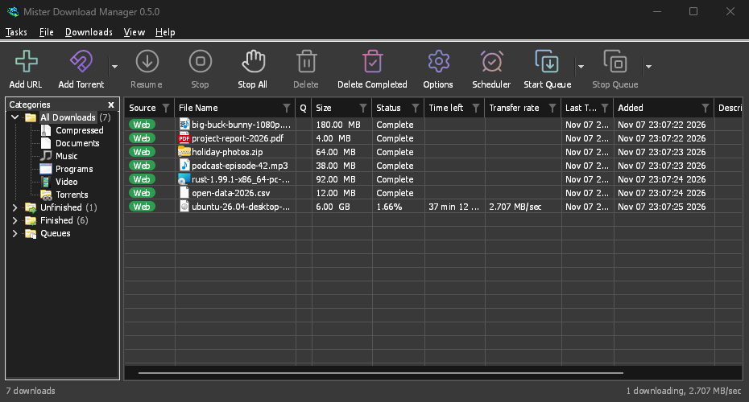
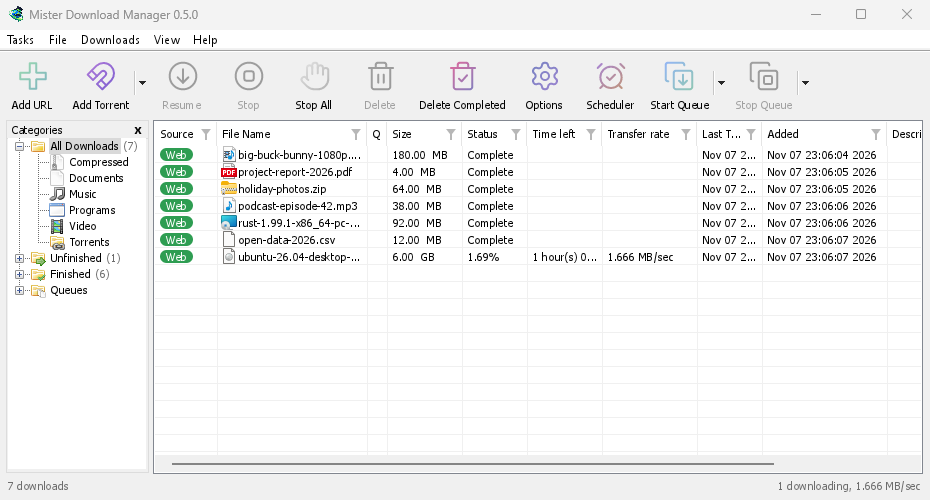
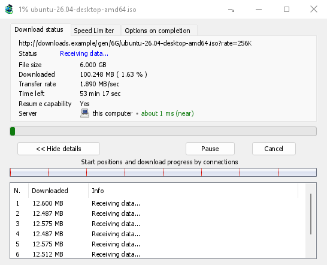

# Mister Download Manager

High-speed open-source file grabber and torrent client delivering up to 5x faster transfers than IDM across 86 languages with zero ads, trials, or sign-ups.

## Multi-Threaded Engine & Torrent Columns

- **Segmented HTTP Acceleration**: Splits large files into parallel streams with slow-disk buffering and automatic resume.
- **Built-In Torrent Control**: Select individual files via `Torrent -> Files` and track live `Peers` and `Share ratio` columns.
- **Browser Extensions**: One-click media and YouTube capture for Chrome, Firefox, Edge, Brave, Opera, Vivaldi, and Safari.

### Browser Integration Setup

Install the companion extension from the Chrome Web Store or Firefox Add-ons, then enable page-title media naming in `browser/extension_map.json`.
